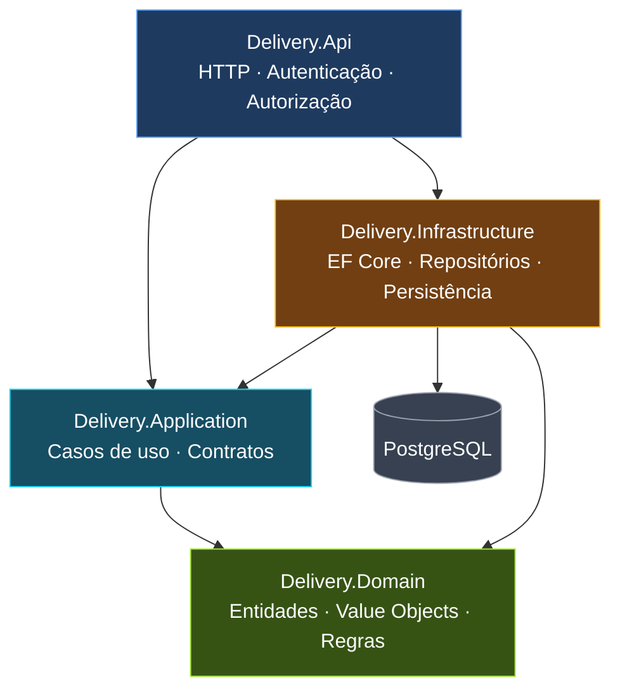

# Delivery Platform

Plataforma de delivery desenvolvida com **C# e .NET 10**, estruturada para suportar múltiplos restaurantes, utilizadores e permissões específicas por restaurante.

O projecto adopta uma arquitectura em camadas, com separação entre regras de negócio, casos de uso, infraestrutura e exposição HTTP. O domínio mantém-se independente dos detalhes de implementação da infraestrutura.

> **Estado do projecto:** em desenvolvimento activo. A implementação actual inclui autenticação, gestão de restaurantes, memberships e persistência de convites para membros.

## Tecnologias

- **.NET 10 / ASP.NET Core**
- **C#**
- **Entity Framework Core 10**
- **PostgreSQL 18**
- **ASP.NET Core Identity**
- **Docker Compose**
- **Redis**
- **xUnit**
- **Testcontainers**

## Arquitectura

A solução está dividida em seis projectos:

| Projecto | Responsabilidade |
|---|---|
| `Delivery.Domain` | Entidades, objectos de valor e regras de negócio |
| `Delivery.Application` | Casos de uso, contratos e serviços de aplicação |
| `Delivery.Infrastructure` | Persistência, Entity Framework Core e implementações dos contratos |
| `Delivery.Api` | Endpoints HTTP, autenticação e composição da aplicação |
| `Delivery.UnitTests` | Testes unitários das regras de domínio e casos de uso |
| `Delivery.IntegrationTests` | Testes de integração da API e persistência |

### Organização das dependências

A arquitectura segue o princípio de inversão de dependências. A camada de aplicação define os contratos de que necessita, enquanto a infraestrutura fornece as respectivas implementações.



O domínio não depende de frameworks de infraestrutura. A aplicação define os casos de uso e os contratos necessários à sua execução. A infraestrutura implementa esses contratos, enquanto a API é responsável pela exposição HTTP e pela composição das dependências.

### Persistência e Unit of Work

A persistência utiliza Entity Framework Core através de repositórios e de uma abstracção de Unit of Work.

- Os repositórios são responsáveis pelo acesso e acompanhamento das entidades.
- A aplicação controla quando as alterações devem ser persistidas.
- A Unit of Work centraliza a chamada a `SaveChangesAsync`.
- As alterações realizadas numa única operação de `SaveChangesAsync` são executadas dentro da transacção gerida pelo provider relacional do Entity Framework Core.

Esta abordagem permite que um caso de uso altere várias entidades e persista as alterações numa única operação.

## Funcionalidades implementadas

### Autenticação

- Registo de utilizadores.
- Login com email e password.
- Logout.
- Consulta do utilizador autenticado.
- Autenticação baseada em cookies HttpOnly.
- Protecção contra CSRF através de antiforgery tokens.
- Controlo de acesso através de autorização.

### Restaurantes

- Criação de restaurantes.
- Listagem dos restaurantes associados ao utilizador autenticado.
- Consulta dos detalhes de um restaurante.
- Memberships entre utilizadores e restaurantes.
- Papéis de `Owner`, `Manager` e `Staff`.
- Estados de membership: `Invited`, `Active` e `Suspended`.

Um utilizador pode estar associado a vários restaurantes. A autorização e o papel do utilizador são determinados individualmente para cada restaurante.

### Convites para membros

- Criação de convites associados a um restaurante.
- Convites identificados por endereço de email.
- Atribuição de papéis de `Manager` ou `Staff`.
- Armazenamento de hash do token de convite.
- Controlo de validade através de data de expiração.
- Estados de convite: `Pending`, `Accepted`, `Revoked` e `Expired`.

A entidade de convite faz parte do agregado `Restaurant`. A persistência e as regras de transição de estado estão implementadas no domínio.

> Os casos de uso e endpoints para aceitação e revogação de convites ainda não estão implementados.

## Requisitos

Antes de executar o projecto, instala:

- [.NET 10 SDK](https://dotnet.microsoft.com/download/dotnet/10.0)
- [Docker Engine](https://docs.docker.com/engine/install/)
- [Docker Compose](https://docs.docker.com/compose/install/)

Para executar as migrations manualmente, também será necessário o Entity Framework Core CLI.

## Configuração local

### 1. Clonar o repositório

```bash
git clone https://github.com/ffakira/delivery-platform.git

cd delivery-platform
```

### 2. Configurar as variáveis de ambiente

Cria um ficheiro `.env` na raiz do repositório:

```env
# PostgreSQL
POSTGRES_PASSWORD=change_me_postgres
ConnectionStrings__DefaultConnection=Host=localhost;Port=5434;Database=delivery;Username=delivery;Password=change_me_postgres

# Redis
REDIS_PASSWORD=change_me_redis

# CORS
Cors__AllowedOrigins__0=http://localhost:5173
```

Substitui os valores de password por valores próprios.

O endereço CORS apresentado é um exemplo para um frontend local executado com Vite. Ajusta-o caso utilizes outra origem.

**Não partilhes o ficheiro `.env` nem coloques credenciais reais no controlo de versões.**

### 3. Iniciar os serviços

```bash
docker compose up -d
```

O Compose disponibiliza:

| Serviço | Endereço local |
|---|---|
| PostgreSQL | `localhost:5434` |
| Redis | `localhost:6381` |

Para verificar os serviços:

```bash
docker compose ps
```

Para consultar os logs:

```bash
docker compose logs -f
```

### 4. Instalar o Entity Framework CLI

```bash
dotnet tool install --global dotnet-ef --version 10.0.14
```

Se já estiver instalado:

```bash
dotnet tool update --global dotnet-ef --version 10.0.14
```

### 5. Aplicar as migrations

Na raiz do repositório:

```bash
dotnet ef database update \
  --project Delivery.Infrastructure \
  --startup-project Delivery.Api
```

As migrations estão localizadas em:

```text
Delivery.Infrastructure/
└── Persistence/
    └── Migrations/
```

### 6. Executar a API

```bash
dotnet run --project Delivery.Api
```

A configuração de desenvolvimento disponibiliza:

- HTTP: `http://localhost:5049`
- HTTPS: `https://localhost:7235`

O documento OpenAPI pode ser consultado em:

```text
https://localhost:7235/openapi/v1.json
```

O endpoint OpenAPI é disponibilizado apenas no ambiente de desenvolvimento.

## Executar os testes

### Testes unitários

```bash
dotnet test Delivery.UnitTests
```

### Testes de integração

```bash
dotnet test Delivery.IntegrationTests
```

Os testes de integração utilizam Testcontainers para criar uma instância isolada de PostgreSQL. É necessário ter o Docker em execução.

### Executar todos os testes

```bash
dotnet test DeliveryPlatform.slnx
```

### Compilar a solução

```bash
dotnet build DeliveryPlatform.slnx
```

## Endpoints disponíveis

Os endpoints da API estão organizados por grupos.

### Autenticação

| Método | Endpoint | Descrição | Autenticação |
|---|---|---|---|
| `GET` | `/api/auth/csrf-token` | Obter token CSRF | Não |
| `POST` | `/api/auth/register` | Registar utilizador | Não |
| `POST` | `/api/auth/login` | Iniciar sessão | Não |
| `POST` | `/api/auth/logout` | Terminar sessão | Não |
| `GET` | `/api/auth/me` | Consultar utilizador autenticado | Sim |

### Restaurantes

| Método | Endpoint | Descrição | Autenticação |
|---|---|---|---|
| `POST` | `/api/restaurants/` | Criar restaurante | Sim |
| `GET` | `/api/restaurants/` | Listar os meus restaurantes | Sim |
| `GET` | `/api/restaurants/{restaurantId}` | Consultar detalhes do restaurante | Sim |

Os pedidos `POST` protegidos por antiforgery necessitam do cookie CSRF e do header `X-CSRF-TOKEN`.

## Estrutura do repositório

```text
DeliveryPlatform/
├── Delivery.Api/
│   ├── Endpoints/
│   ├── Extensions/
│   └── Properties/
├── Delivery.Application/
│   ├── Abstractions/
│   │   └── Persistence/
│   └── Restaurants/
│       ├── Commands/
│       ├── Queries/
│       ├── Repositories/
│       └── Services/
├── Delivery.Domain/
│   └── Restaurants/
│       ├── Entities/
│       ├── Enums/
│       └── ValueObjects/
├── Delivery.Infrastructure/
│   ├── Identity/
│   └── Persistence/
│       ├── Configurations/
│       ├── Migrations/
│       └── Repositories/
├── Delivery.IntegrationTests/
│   ├── Infrastructure/
│   └── Restaurants/
├── Delivery.UnitTests/
│   └── Restaurants/
├── compose.yml
└── DeliveryPlatform.slnx
```

## Desenvolvimento

O projecto segue os seguintes princípios de engenharia:

- Separação entre domínio, aplicação e infraestrutura.
- Inversão de dependências.
- Regras de negócio independentes de persistência.
- Casos de uso explícitos.
- Persistência através de Entity Framework Core.
- Unit of Work para controlar a fronteira de persistência.
- Testes unitários para validar regras e comportamentos.
- Testes de integração para validar os fluxos reais da aplicação.
- Autorização baseada na membership do utilizador em cada restaurante.

## Licença

Este projecto encontra-se em desenvolvimento. A licença ainda não foi definida.
